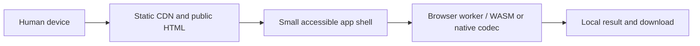
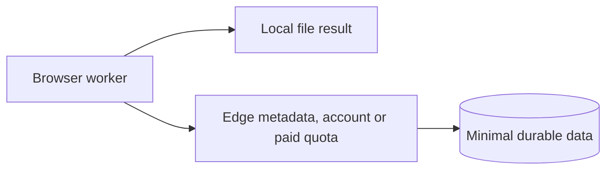
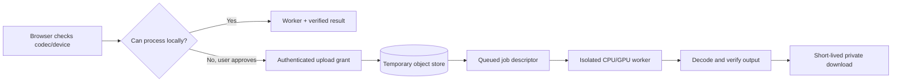

# Production architecture selection: find the cheapest *correct* execution route
**Date:** 2026-11-23 · **Owns:** `web-workload-architecture-router` · **Type:** Decision framework, not a deployment benchmark.

## The falsifiable goal
Pick the least expected **cost per correctly completed human task** subject to correctness, privacy, abuse resistance, latency, accessibility and reliability constraints. "Cheapest stack" without specifying which transformation, input and output cannot be a defensible answer. Explicitly test at least two alternatives (browser-local versus cloud hybrid, then edge/server/containers as appropriate); explain why one fails.

Objective (illustrative): minimize total 30-day infrastructure + support + compliance + engineering cost / verified completed jobs, subject to chosen output-oracle/latency/privacy SLO and hard spend limit. Search eligibility and publisher policies are independent requirements, not architecture's output.

## Seven real workload families
| Family | Typical tools | Default *candidate* | Why this can fail |
|---|---|---|---|
| Deterministic math/text | Unit/date calculators, generators, encoders, JSON tools | Static public HTML with lazy browser JS | Some tasks require current server-side data; precision, XSS and accessibility can still break |
| Native/WASM image/media | Image resizing, transparency converter, color picker | Browser native APIs + Web Worker + optional WASM | Codec absence, low-RAM Android, memory, color management, massive file, battery |
| Heavy media | Video transcode, big PDF OCR, mass extraction | Browser only where proven; otherwise upload grant + queue + isolated CPU/GPU | CPU time, output quality, egress, storage, queue, codec licenses, abuse |
| Lookup/reference | Dynamic datasets, government APIs, dictionaries | Cached static snapshots + edge lookup, DB only when state justified | Freshness, licensing, stale/corrupt answer, DB read amplification |
| AI inference | Summarizer, background remover, OCR with ML, classification | Browser ML for narrow supported devices; otherwise task-budgeted provider router | Token/GPU cost, prompt injection, billing, privacy, model variance |
| Network/external | Website analysis, screenshot/render, crawling/monitoring | Explicitly authorized remote fetch in isolated server executor | SSRF, robots/terms, site abuse, bandwidth, anti-bot challenges |
| Collaborative/account | Resume editor with save, shared project, sync | Static public entry + authenticated API + durable state | Auth, conflict resolution, backups, multi-user access, RBAC, retention |

A single "one stack for all sites" invites unnecessary server spending or unsupported browser features. Astro is one possible static frontend; exact framework remains a *tooling decision after the architecture*. A modern CDN static site can deliver millions of pageviews without a per-view compute execution when configured correctly; ad scripts, asset delivery and third-party services still have limits/costs.

## Required workload intake
`{ user_job, output_oracles, file_types, avg_input_mb, p95_input_mb, max_input_mb, cpu_seconds_per_job, peak_browser_ram_mb, device_ram_budget_mb, target_p95_seconds, remote_allowed_by_user, sensitive_data, storage_retention_hours, MAU, jobs_per_MAU, peak_to_average, abuse_fraction, available_budget_USD }`.
Every unknown critical number MUST be modeled as a range or blocked until benchmarked. One million MAU does **not** imply 1M simultaneous jobs; 1M users × 3 tasks/mo means 3M jobs/mo if those assumptions hold. Seasonal peaks can be 10–100× average. Product claims must survive same-file competitor comparisons.

## Architecture patterns
### A. No backend processing (cheapest when task permits)

Keep search-readable HTML and lazy load heavy logic only on interaction. Native APIs before huge WASM when supported; side-effects and analytics require network/privacy audit. App's actual file payload stays local **only if** the network-interception test proves that claim across code paths.

### B. Edge metadata/control plane + browser-local task

Do not route file bytes through the API when they need not travel. Request pricing now comes into play for actual Worker invocations and DB rows; CDN static requests have distinct billing.

### C. Hybrid consented remote fallback, not silent upload

Cloud execution requires external billing and guardrails. Use short-lived scoped access, owner checks, timeout, idempotency, finite retries, dead-letter queues, manual/automatic deletion validation. Avoid raw file upload through memory-limited edge handlers.

### D. AI provider or own model
Use model router with quality thresholds, per-user token ceiling, cache only public/consented inputs, BYOK option when business justifies it, fallback with hard maximum cost. Hosted GPU is not automatically cheaper than a priced API; compare measured throughput and utilization over a real work mix.

## Cloudflare-specific constraints, not universal endorsements
Current Workers paid (2026-11-23) lists $5 account base, 10M included Worker invocations/mo, 30M included CPU-ms, $0.30 per extra million requests and $0.02 per million CPU-ms; static asset requests are distinct and can be served for no Worker charge. The runtime is **128 MB per isolate**. Pages Free documented **20K asset files per site** and **25 MiB per asset**, not unlimited file capacity. Larger uploads should avoid proxying through Workers; R2 supports direct presigned browser uploads. See official:
- https://developers.cloudflare.com/workers/platform/pricing/
- https://developers.cloudflare.com/workers/platform/limits/
- https://developers.cloudflare.com/pages/platform/limits/
- https://developers.cloudflare.com/r2/objects/upload-objects/

The pricing is a snapshot and may differ by plan, scope, product or actual invoice. For a private React/Astro app that loads 5MB of JS to calculate 2+2, the technology is the problem, not CDN speed.

## Architecture decision record / stop conditions
Record: goal; input/output oracle; latency and privacy constraints; browser capability matrix; failure outcomes; topology candidates; reference price card; predicted cost/job including retries; observed p50/p95; abuse and cancellation; provider failover; migration trigger; real user benchmark; owners and test hashes.

Hard reject: no actual useful result, no low-end fallback, unpriced server compute, no quotas, no direct signed upload for large files, claims of absolute privacy without network evidence, or missing user's approval for remote processing. Escalate to `web-unit-economics-finops`, `web-conversion-job-platform`, `web-scale-reliability`.
