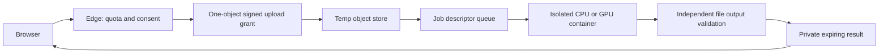

# Fully functional file/image/PDF/media tools — browser-local and safe cloud pipelines
**Date:** 2026-11-23. **Owners:** `web-browser-compute`, `web-conversion-job-platform`, `web-product-validation`.

## Native vs WASM vs server: a measurable capability problem
Browser-only conversion saves billable **server-side task execution**, not necessarily all costs or user device energy. Start from native File/Blob APIs, Canvas/OffscreenCanvas, WebCodecs, Web Workers and browser-supported decoders. Add maintained WASM engines only for functions native APIs cannot meet, evaluating legal/codec licenses. For supported devices, real-world browser WebCodecs/WebGPU pipelines can avoid server video processing; Google documented a 250K MAU client-side AI video upscaler case study. This is evidence of feasibility for *that class of pipeline*, not universal phone or format support. https://web.dev/case-studies/ai-video-upscaler-case-study ; https://web.dev/articles/webassembly-performance-patterns-for-web-apps

### Browser pipeline contract
1. Capability detection BEFORE loading 20MB codec: verify API, codec encode/decode availability, estimated memory budgets, file size and actual browser family.
2. Present user-selected input and privacy statement; no silent upload or telemetry of document contents. For local-only claim, test network requests and fallback code paths.
3. Validate file signature/type/headers, file upper bound, pixel/frame/page counts and compressed expansion bombs. Never trust extension or MIME alone.
4. Transfer/process data in Web Worker; avoid full-file copies, streaming when supported, reuse encoded buffers, revoke object URLs and release worker resources on cancel/finish.
5. Enforce memory cap and fairness. OPFS is quota-limited and can be evicted; use only with cleanup and quota checks. Private-to-origin does NOT mean encrypted, backed up, device-independent or available without browser storage. https://developer.mozilla.org/en-US/docs/Web/API/File_System_API/Origin_private_file_system
6. Preserve image color profile/EXIF orientation/alpha where applicable; verify actual output bytes and decode with an independent decoder. For PDF check page count/text/font fidelity and signatures/password limitations; for audio/video inspect duration, channels, FPS, codecs, container metadata.
7. Emit progress with meaningful stages, cancel, actionable errors and downloadable output only when valid. Screen-reader announcements/keyboard and no-JS public explainer stay usable.
8. If unavailable locally, show an **opt-in** remote processing choice with transparent provider region, retention, input constraints, approximate waiting time (not guaranteed), server cost/plan and explicit deletion policy.
9. Measure p50/p95 end-to-end time, peak RAM, CPU/battery, user abandon, retries and download success by mobile low-end/desktop/browser. The device is the user's computer, not a free server.

### Supported outputs must be proven per transformation
| Tool | Minimum fixture+oracle |
|---|---|
| JPEG/PNG/WebP/AVIF/HEIC | Transparency/alpha, EXIF orientation, ICC profile, pixel size, target bytes and independent image decoder |
| SVG sanitizer | Malicious onload/external references, XSS defense, input trust, deterministic safe serialization |
| PDF merge/split | Page ordering, text/images preserved, encryption/signature impact, large/scanned case, output reopen |
| QR/Barcode | Payload/correction, size, scanability on real device, malicious URL/XSS handling |
| MP4→MP3 | Decoder input/copyright/codec rights, audio extraction, channels/sample rate, output duration, no silent transcoding error |
| Video compress | FPS, VFR, A/V sync, bitrate, duration, seekability, quality, output size, memory and device codec availability |
| ZIP/tar/other archives | Path traversal, symlinks, compressed expansion/zip bombs, directory flags, correct CRC and member count |
| OCR | Known ground truth text, language, scanned/rotated pages, confidence and explicit unsupported cases |
| AI output | Ground-truth eval, hallucination safeguards, moderation/rights, privacy and model token cost |

### Safe async server pipeline

- Signed URLs should be short TTL and scoped to one operation and object; server confirms object size/type after upload and never shares permanent storage credentials. Provider specifics matter: R2 direct browser PUT presigned URL; multipart for large files. https://developers.cloudflare.com/r2/objects/upload-objects/ ; https://developers.cloudflare.com/r2/api/s3/presigned-urls/
- Stateful job transitions must be authorized and idempotent. Queue delivery typically at least once; duplicates must not generate duplicate work/payment.
- Isolate untrusted codecs/FFmpeg/Tesseract/PDF tools with process and network restrictions, CPU and RAM cap, no host path access, stream limits, no unsafe URL import or SSRF.
- Bound customer-specific and global expensive job budgets BEFORE enqueue, with queue depth threshold and finite retry/dead-letter semantics.
- Validate result file independently, write release status atomically, cleanup temp files and expired jobs, test actual deletion lifecycle (including backups/logs). Do not promise 8h retention without measuring it.
- Keep user privacy (regional storage, deletion, consent) and ad policy separate from computation.

## Decision from metrics
Stay browser-only when 98%+ of intended actual task fixtures pass within acceptable p95 memory/latency/privacy. If critical formats fail on target devices, add explicit fallback or scope down, not an automatic hidden upload. Move only failure cohorts to cloud if cloud marginal cost and policy can be sustained. Server job workloads should have a negotiated budget and user fairness controls before scaling.

**Proof needed:** actual fixture hashes, device/codec matrix, worker time/RAM traces, network interception, output oracle, cancellation/failure tests, account-specific cloud price, and load-test results. This document itself does not satisfy those proofs.
