# Search visibility operations — from HTTP bytes to durable user acquisition
**Reviewed 2026-11-23.** Owning skills: `web-search-forensic-evidence`, `web-technical-seo`, `web-content-and-image-seo`, `web-search-analytics`, `web-generative-engine-optimization`.

## End-to-end search pipeline

```mermaid
flowchart LR
   Need[Real task demand] --> Route[Distinct useful page + output]
   Route --> Access[Robots/TLS/HTTP/canonical/internal links]
   Access --> Discover[Crawler fetch + index selection]
   Discover --> Rank[Opaque ranking candidate evaluation]
   Rank --> Result[Organic / image / video / AI links]
   Result --> Human[Human click -> actual tool completion]
   Human --> Reuse[Repeat use, legitimate referrals, product iteration]
```

This describes dependencies, not a claim that search engines run this exact sequential pipeline for every query. Every arrow has separate test methods.

## Technical eligibility and crawl monitoring
- DNS/TLS, stable 200; correct true 404/410; direct 301 from old URLs; temporary 429/503 semantics and Retry-After on genuine overload, not crawler cloaking.
- Initial HTML contains semantic title/H1, core textual info, real `<a href>` links, visible supported formats, working user task entry and unique content; Google can render JS but other fetchers vary.
- Canonical and hreflang audited for duplicates, translations and parameterized variants; paginated/faceted pages must not flood crawl.
- Accurate sitemap index + lastmod, descriptive internal links and link depth, real robots exclusions; noindex not accidentally present in rendered/app initial state.
- Cache headers/ETags for genuinely unchanged assets, CDN warm-up before migration; cold cache surges can amplify origin load.
- Verify Googlebot, Bingbot and relevant AI Search crawlers by published IP/reverse DNS or authenticated bot methods rather than user-agent alone. Treat user-triggered agents separately.
- Search Console ownership is required to prove coverage/impressions, real crawl snapshots and indexed status. Sitemaps/IndexNow submit URLs, not guaranteed indexing.

Primary: https://developers.google.com/search/docs/crawling-indexing/ ; https://developers.google.com/search/docs/crawling-indexing/javascript/javascript-seo-basics ; https://developers.google.com/search/blog/2026/11/crawling-cdn ; https://www.indexnow.org/documentation .

## Matching query to real useful action
Exact keywords in URL/title/H1 are useful where natural. Intent matching, actual completed job, original benchmark evidence, safety, software limitations and usable cross-links matter more than artificial keyword frequency. One page for one true distinct conversion can be warranted; dozens of superficial swapped synonyms cannot.
Build a keyword→user job→fixture→page map and objective intent disambiguation. Competitor authority and SERP composition fluctuate; use current source evidence, not fixed “Google first 10 links” assumption.

## Multi-surface visibility
- **Google Search organic:** index eligibility, helpful and original content, interlinking and human utility; ranking opaque.
- **Google AI Mode/Overviews:** indexed+snippet-eligible pages; no special llms.txt needed or AI-only structured data; query fan-out can cite other query candidates.
- **ChatGPT Search, Claude, Perplexity, Brave, Bing:** provider bots or search indexes have distinct access and live citation behavior. `web-generative-engine-optimization` owns prompt-panel verification; no borrowed weights from Google.
- **Images/visual search:** crawlable images, useful alt/context and original picture/benchmark; copyright/licenses, appropriate photo metadata where needed.
- **Videos:** watch page when video is main content, supported structured VideoObject accurately visible, usable transcripts/captions.
- **Discover:** useful images and audience interest, separate Search vs feed distribution; cannot force impressions via 16:9 thumbnails.
- **Regional/local/store:** app-store discovery belongs to Google Play/Apple ASO, not general Search; country/language behavior requires own tests.
- **Agent browsers:** semantic controls, keyboard/a11y tree, optional experimental WebMCP only when user tasks need them. Lighthouse agentic score is not a Google ranking score.

Primary: https://developers.google.com/search/docs/fundamentals/ai-optimization-guide ; https://developers.google.com/search/docs/appearance/ai-features ; https://developers.google.com/search/docs/appearance/google-discover ; https://developers.google.com/search/docs/appearance/video ; https://developer.chrome.com/docs/lighthouse/agentic-browsing/scoring .

## Search Console and owned attribution
Keep separate records for impression, organic click, AI citation displayed, model mention without citation, AI referral session, successful human tool outcome, valid ad impression and actual publisher income. No joint 'SEO/GEO score' collapsing incomparable metrics. Use query and country panels over time with product changes logged; control for core updates, SERP layout, promotions and seasonality. An Ahrefs/Semrush visit estimate is a directional competitor model—not owned analytics.
Review algorithm and documentation changelog routinely: https://developers.google.com/search/updates .

## Production SEO QA battery
Fetch raw content with a real HTTP client and browser without JS; inspect 200/301/404/410, canonical and metadata, sitemap URL ownership, href paths, robots/WAF, structured-data match, archive of page content and screenshots. Include orphan detection and duplicate task page graph. Test user tools with real file-output oracle, low-end mobile compatibility, and actual useful content; Search cannot compensate for broken product functionality.
